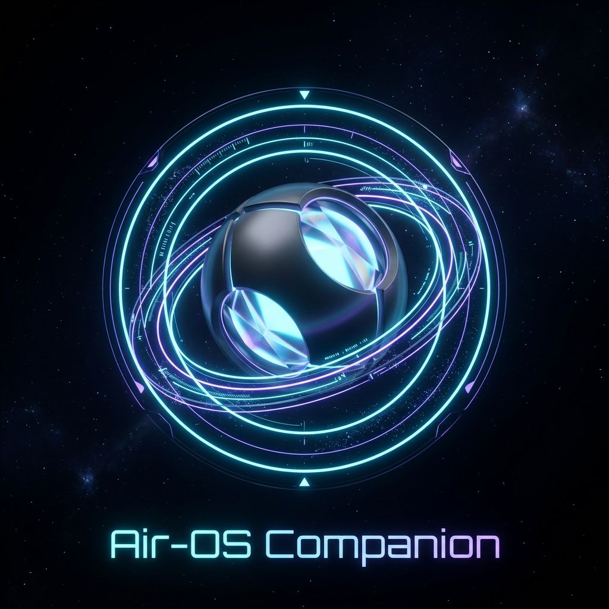
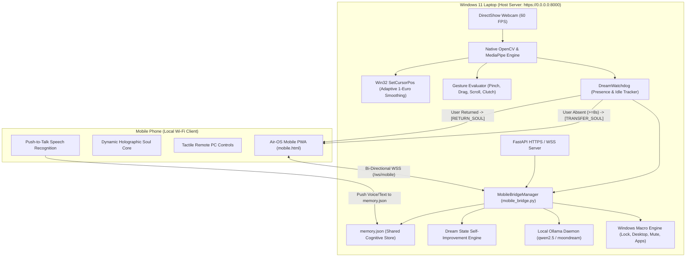

# Air-OS: Autonomous Spatial Gesture Engine & Mobile AI Companion

<p align="center">
  
</p>

<p align="center">
  <b>A zero-latency, 60 FPS spatial hand-tracking operating system and real-time mobile Wi-Fi cognitive companion for Windows 11.</b>
</p>

<p align="center">
  
  
  
  
  
  
</p>

---

## 🌟 Overview

**Air-OS** bridges spatial computer vision, local cognitive AI models, and real-time mobile telemetry into a unified pair of companion applications:

1. **Laptop Cockpit (Desktop App):** A single-page, luxury cybernetic command deck running in standalone Windows App Mode. Features 60 FPS DirectShow camera tracking, 1-Euro velocity-adaptive cursor smoothing, multi-hand macro combos, and offline Ollama intelligence with persistent memory.
2. **Mobile Companion (Phone App):** A standalone Progressive Web App (PWA) with full-screen native execution, touch haptics, and Web Speech API push-to-talk. Features **Autonomous State Transfer (`TRANSFER_SOUL`)**: when you walk away from your desk, the companion automatically hops into your phone over Wi-Fi.

---

## 🏛️ System Architecture



---

## ✨ Key Features

### 1. Spatial Vision & Cursor Tracking (Laptop)
- **DirectShow 60 FPS Native Pipeline:** Reads webcam frames via Windows DirectShow (`cv2.CAP_DSHOW`) with low-latency buffering (`BUFFERSIZE = 1`).
- **Knuckle Landmark Tracking:** Tracks cursor position using Landmark 5 (Index MCP Knuckle) for rock-solid stability and zero jitter when clicking.
- **Adaptive Velocity Smoothing (1-Euro Style):** Dynamically adjusts smoothing factor based on hand velocity. Fast movements track with zero rubber-band lag; micro-movements remain pin-point accurate.
- **Background Persistence:** Runs inside a dedicated native C++ / Python background worker thread that **never pauses or throttles** when the browser is minimized.

### 2. Autonomous State Transfer (`TRANSFER_SOUL`)
- **Presence Watchdog:** Continuously monitors whether you are present in front of your laptop webcam.
- **Walking Away ($\ge 8\text{s}$):** Server automatically dispatches a `TRANSFER_SOUL` event. The phone app lights up in radiant purple: *"Air-OS Soul Transferred to Mobile"*.
- **Returning to Desk:** The webcam detects your presence and returns the companion: *"Soul docked back to laptop"*.
- **Manual Control:** A one-tap button on both phone and laptop lets you summon or dock the companion at will.

### 3. Shared Cognitive Memory & Self-Improvement (Dream State)
- **Unified `memory.json` Store:** All user interactions (desktop chat, mobile voice notes, webcam snapshots, macro executions) are permanently logged with timestamps, client channels, and workflow state.
- **Autonomous Dream State:** When zero presence is detected for 10+ minutes (or triggered manually), Air-OS invokes a local Ollama model to self-reflect on the day's memories, extract behavioral preferences, and **autonomously rewrite its own system prompt** stored in `system_prompt.txt` (versioned in `prompt_history/`).

### 4. Dual Standalone Apps
- **Laptop App:** Launches in borderless Windows App Mode via [`start_desktop_app.bat`](start_desktop_app.bat) with its own taskbar presence.
- **Mobile App:** Installs onto iOS Safari and Android Chrome as a native PWA with app icons, touch vibration, and full-screen execution.

---

## 📋 Prerequisites

- **Operating System:** Windows 10 or Windows 11 (64-bit)
- **Webcam:** Any built-in or USB webcam
- **Python:** Python 3.10, 3.11, or 3.12 (with pip)
- **Node.js:** Node.js 18+ and npm
- **Local Ollama (Recommended):** [Download Ollama](https://ollama.com/) and pull a fast model:
  ```bash
  ollama run qwen2.5:0.5b
  # For webcam visual analysis (optional):
  ollama pull moondream:1.8b
  ```

---

## 🚀 Installation & Setup Guide

### 1. Clone the Repository
```bash
git clone https://github.com/shoryasrivastava388-sys/Air-OS.git
cd Air-OS
```

### 2. Backend Setup (Python)
```powershell
cd backend
python -m venv .venv
.\.venv\Scripts\Activate.ps1
pip install -r requirements.txt
cd ..
```

### 3. Frontend Setup (React & Vite)
```powershell
cd frontend
npm install
npm run build
cd ..
```

---

## 🎮 Launching the Apps

### A. Laptop App (Desktop Cockpit)
Double-click [`start_desktop_app.bat`](start_desktop_app.bat) or run from PowerShell:
```powershell
.\start_desktop_app.bat
```
This automatically boots the native vision engine, starts the HTTPS backend, and opens the borderless standalone desktop window.

### B. Mobile App (Phone Companion)
1. Ensure your phone is connected to the **same Wi-Fi network** as your laptop.
2. Find your laptop's local IP (e.g., `192.168.31.18`).
3. Open Safari (iOS) or Chrome (Android) on your phone and navigate to:
   ```text
   https://<YOUR_LAPTOP_IP>:8000
   ```
   *(Accept the self-signed SSL certificate notice once: tap **"Advanced"** $\rightarrow$ **"Proceed"**).*
4. **Install as a Home Screen App:**
   - **iPhone (Safari):** Tap the **Share button** ⎋ $\rightarrow$ **"Add to Home Screen"** 📲 $\rightarrow$ **"Add"**.
   - **Android (Chrome):** Tap **"+ App"** at the top (or `⋮` $\rightarrow$ **"Install app"**).

---

## 🖐️ Spatial Gesture Reference Card

| Gesture | Landmark Trigger | Windows Action |
| :--- | :--- | :--- |
| **Index Pinch** | Thumb Tip $\leftrightarrow$ Index Tip $< 0.05$ | **Left Click** |
| **Middle Pinch** | Thumb Tip $\leftrightarrow$ Middle Tip $< 0.05$ | **Right Click** |
| **Pinch & Hold** | Index Pinch held $> 0.35\text{s}$ | **Drag & Drop** |
| **Ring Pinch** | Thumb Tip $\leftrightarrow$ Ring Tip $< 0.05$ | **Smooth Vertical Scroll** |
| **Closed Fist** | All 4 fingertips below PIP joints | **Clutch / Pause Cursor** |
| **Portal Magic** | Both Index Fingertips touch ($< 30\text{px}$) | **Open Web Browser / URL** |
| **X-Shield** | Both Wrists crossed ($< 60\text{px}$) | **Show Desktop (Win + D)** |

---

## 📁 Repository Structure

```text
Air-OS/
├── backend/
│   ├── main.py                 # FastAPI backend, DirectShow vision, MediaPipe tracking
│   ├── mobile_bridge.py        # Wi-Fi WebSocket bridge & state transfer manager
│   ├── dream_engine.py         # Cognitive memory store & self-improvement loop
│   ├── ensure_certs.py         # Automatic local SSL certificate generator
│   ├── memory.json             # Persistent cognitive interaction database
│   ├── system_prompt.txt       # Self-optimized system prompt
│   ├── prompt_history/         # Versioned prompt archive
│   ├── requirements.txt        # Pinned Python dependencies
│   └── static/
│       ├── mobile.html         # Luxury cybernetic mobile PWA client
│       ├── manifest.json       # Mobile Web App manifest
│       ├── sw.js               # Service Worker for offline PWA
│       └── airos_icon.jpg      # High-resolution companion emblem
├── frontend/
│   ├── src/
│   │   ├── App.tsx             # Unified 3-deck luxury desktop cockpit
│   │   ├── main.tsx            # React application entrypoint
│   │   └── index.css           # Modern cybernetic styles & fonts
│   ├── public/
│   │   ├── manifest.json       # Desktop PWA manifest
│   │   └── airos_icon.jpg      # Desktop app icon
│   ├── package.json            # Node.js dependencies & scripts
│   └── vite.config.ts          # Vite configuration
├── start_desktop_app.bat       # One-click Windows desktop app launcher
├── start_mobile_bridge.bat     # One-click mobile Wi-Fi bridge launcher
├── .gitignore                  # Production gitignore
└── README.md                   # Complete documentation
```

---

## 🔒 Privacy & Local Security

- **100% Offline Processing:** Camera frames and hand landmarks are evaluated entirely on your CPU via MediaPipe C++ bindings. No video frames are ever uploaded to cloud servers.
- **Local AI Inference:** Chat queries and dream state reflections run locally on your hardware via Ollama (`127.0.0.1:11434`).
- **Encrypted Local Wi-Fi Bridge:** Mobile communication uses HTTPS and WSS (WebSocket Secure) with dynamic local Subject Alternative Name (SAN) SSL certificates.

---

## 📜 License

MIT License. Crafted with advanced agentic engineering for Windows 11 and modern mobile devices.
